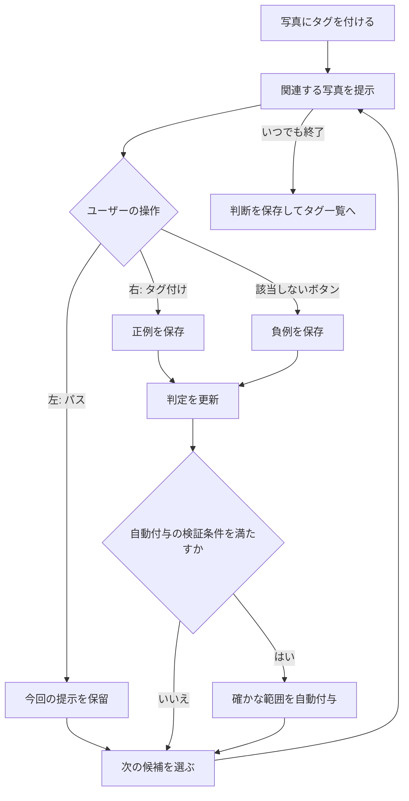
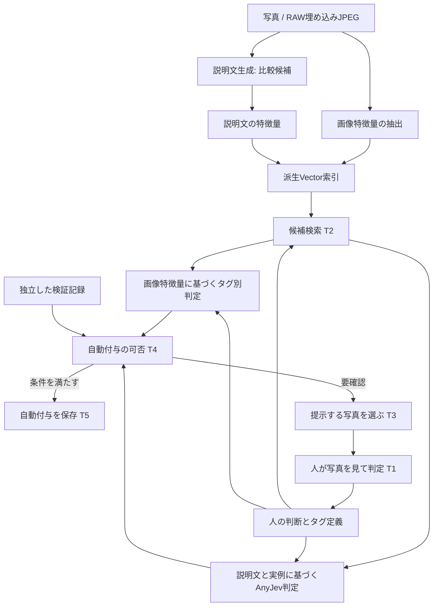

# ユーザーの判断から広げるタグ付け — 目的駆動設計案

2026-10-25追記: 後続の開発依頼と回答に基づき、Android内の手動タグ付けを実装した。現在の合意・契約・実測・未検証事項は[開発記録](tag-judgment-contract.md)を参照。以下はIssue起票時点の設計案であり、検索・自動付与の採用合意ではない。

作成日: 2026-10-25（日本時間）。対象: `ab903e5` と現在の作業ツリー。設計のみ。アプリ実装・モデル実行・実機検証は未実施。

## 文脈と合意の範囲

Loupeの既存の目的は「写真を見返し、選び、使い続ける」。本機能は[現行設計](current-design.md)のP1「写真を探して確認する」を拡張する。

| 区分 | 内容 |
|---|---|
| 現行動作（コード読解） | Android 11以降、Java。RAWは埋め込みJPEGを利用。GalleryIndexは再構築可能な一覧索引。画像認識は未実装 |
| 今回の依頼 | 目的駆動の設計と図による可視化。実装依頼ではない |
| ユーザーが提示した検討方針 | 最初から汎用タグを自動付与せず、ユーザーのタグ付けを起点に対象を広げる |
| ユーザーの方式案 | 全写真の説明文生成、Vector検索、AnyJevによる分類・Confidence、人の左右スワイプ |
| 本書の提案 | 画像特徴量も検索に利用し、検索・意味判定・人の判断の学習・自動付与の許可を分離する |
| 未決定 | 端末内／Mac／サーバーの処理場所、タグ対象の範囲、許容誤付与率、モデル、容量・時間の予算、左スワイプを負例にするか |

方式案は採用合意と扱わない。以下の契約は実装前の提案であり、性能保証は実測後に決定する。原本保全は既存設計の制約を継承する。

## 最上位の目的 T0: 少ない判断で、自分の意味づけに沿って写真をまとめ、探せる

- 機能: 写真へのタグ付けから関連写真を見つけ、判断を反映しながらタグを広げ、後からその集合を閲覧する。
- 要件: ユーザーが開始したタグのみを扱う。判断回数を減らす一方で誤付与を抑え、訂正できる。解析待ちでも閲覧でき、原本は変えない。
- 達成指標: 同じ許容誤付与率で、自動付与の枚数・取りこぼし・人の判断回数・所要時間を比較する。Confidenceの高さそのものを達成指標にしない。

```mermaid
flowchart TD
    P[写真を見返し、選び、使い続ける] --> V[写真を探して確認する]
    V --> T0[少ない判断で自分の意味づけに沿ってまとめ、探せる]
    T0 --> T1[T1 自分の意図を伝えられる]
    T0 --> T2[T2 関連写真を見落としにくくする]
    T0 --> T3[T3 必要な判断に集中できる]
    T0 --> T4[T4 確かな範囲を自動化できる]
    T0 --> T5[T5 結果を使い、訂正し、再開できる]
    T2 -. 既存P1.2の画像取得保証 .-> E[原本を変えず画像を確認する]
    T4 -. 人の確定判断を参照 .-> T1
    T3 -. 候補集合を参照 .-> T2
    T5 -. 付与の根拠を参照 .-> T4
```

実線は目的の具体化、点線は保証への依存。説明文生成、Vector DB、AnyJevはこの図の目的ではなく、下記の目的を実現する手段。

## 目的 T1: 自分の意図を伝えられる

- 上位との対応: ユーザー固有の分類基準を表せることがT0の「自分の意味づけ」を満たす。
- 機能: タグ名と見本写真を指定し、必要に応じて意味の説明、承認例、除外例を追加する。
- 要件 R1: 一枚から開始できるが、一枚で意味が確定したとは扱わない。同じ写真に複数タグを付けられる。未付与と明示的除外を区別する。
- 不変条件 C1: 人の判断は `付与 / 該当しない / 未判断`。パスは未判断のまま。自動付与は人の正例にならない。タグの表示名と不変のIDを分ける。
- 事前条件: タグと写真の参照が有効。送信した操作IDが識別可能。
- 事後条件: 判断と履歴が保存できた後で確定表示に進む。同じ操作IDの再送は二重記録しない。訂正は以前の判断を無効化する履歴として保存する。
- 意味変更: 名前だけの変更と分類基準の変更を区別。後者はタグ定義の版を進め、過去の判定と自動付与の有効性を再評価する。
- 責務案: TagDefinition、RecordTagJudgment、JudgmentStore。
- 検証予定: 保存失敗、再送、undo、複数タグ、意味変更、未判断が負例に混入しないこと。

## 目的 T2: 関連写真を見落としにくくする

- 上位との対応: 少ない判断で集めても、同じ連写や似た背景だけに対象が偏らないことを保証する。
- 機能: 画像と説明文の検索結果から候補を集め、見本の追加に応じて探索範囲を広げる。
- 要件 R2: 説明文に書かれなかった特徴にも到達できる。解析途中でも利用できる。検索圏外の取りこぼしを点検できる。
- 不変条件 C2: 検索スコアは付与確率ではない。未解析・解析失敗・権限なしを非該当と扱わない。異なるモデルの特徴量を直接比較しない。
- 事前条件: 少なくとも一つの利用可能な見本と、それと互換な特徴量がある。なければ手動操作を継続できる。
- 事後条件: 候補ID、画像版、検索経路、索引版を返す。未解析件数と対象範囲を併記する。候補漏れは否定判定を生まない。
- 方式案: 画像検索と説明文検索の上位集合を重複除去して合流。タグ全体を一つの平均ベクトルに潰さず、複数の承認見本から取得。別撮影日・別背景と検索圏外からも少数を抽出する。
- 責務案: PhotoAnalysis、CandidateRetriever、再構築可能なVector索引。
- 検証予定: 説明文の欠落、連写偏り、未解析混在、索引更新中、近似検索の取りこぼし。

## 目的 T3: 必要な判断に集中できる

- 上位との対応: 無意味な反復を避け、人の操作回数を減らす。
- 機能: 判定が割れる候補、代表的な候補、未探索領域の候補を提示する。
- 要件 R3: 一度の判断が複数候補の判定改善に役立つ。理由の違う確認作業を内部的に区別し、いつでも中断できる。
- 不変条件 C3: 左パスは負例にならない。今回パスした写真は同一セッション内で繰り返し出さない。右付与は正例。明示的な「該当しない」操作だけが負例。一手戻しで学習材料も訂正する。
- 事前条件: 表示写真・タグ定義の版が現在の操作対象と一致する。
- 事後条件: 保存成功後に次の写真へ進み、学習材料の版を更新する。保存失敗時は写真を維持し、再試行可能にする。
- 方式案: 初期は類似候補と多様な候補を提示。正例・負例が集まったら不確実性も利用。迷う写真だけを提示せず、高スコア領域の監査も別枠で行う。
- 責務案: ReviewQueue、ReviewSession、タグ別の軽量分類器。
- 検証予定: パスの循環防止、遅い非同期結果、操作重複、undo直後の更新、終了・再開。

## 目的 T4: 確かな範囲を自動化できる

- 上位との対応: T0の操作削減を、誤付与の許容範囲内で実現する。
- 機能: 推定結果を評価し、自動付与／要確認／今回は提示しない、へ振り分ける。
- 要件 R4: モデルの自信と実際の正しさを区別する。判断材料が不足する場合は自動付与を開始しない。人が除外した写真を自動で付け直さない。
- 不変条件 C4: Confidence単体では自動付与を許可しない。タグ別・判定器版・対象範囲に対応した検証根拠が必要。人の判断が優先。自動付与を学習・精度検証の正解に流用しない。
- 事前条件: 自動化が有効なタグで、閾値・適用範囲・校正／検証記録が利用可能。写真、タグ、学習材料、モデルの版が一致し、人の除外がない。
- 事後条件: 自動付与と判断根拠を一緒に保存。版が変わっていたら破棄し再評価。自動化停止後は未確定のジョブから書き込めない。
- Confidenceの扱い: 検索類似度、AnyJevの選択肢確率、軽量分類器のスコア、検証で得た精度を別々に保存。異なる数値をそのまま平均しない。
- 自動化の基準案: 独立した検証標本で、自動付与対象の適合率の片側信頼下限が合意した目標以上となる閾値を選ぶ。閾値調整用と最終評価用を分離。候補選別による偏り、連写相関を考慮し、標本不足なら未検証と表示する。
- 停止条件: 全写真のConfidence上昇を待たない。現時点で自動化可能な範囲を公開し、曖昧な写真は保留できる。固定回数のスワイプで精度を保証しない。
- 責務案: TagDecision、AutomationPolicy、ApplyAutomaticTag。
- 検証予定: 過信、校正不足、古い結果、手動訂正との競合、モデル更新、対象分布の変化。

## 目的 T5: 結果を使い、訂正し、再開できる

- 上位との対応: 分類作業だけで終わらず、写真を探す価値と継続利用を保証する。
- 機能: タグで絞り込み、自動付与の由来を確認し、取り消して再開する。
- 要件 R5: 一覧再構築や解析更新で人の判断を失わない。自動付与と人の確定を判別できる。解析中でも既存ギャラリーを開ける。
- 不変条件 C5: タグは原本・EXIF・連写順位・共有選択・原本削除条件を変更しない。人の判断は派生索引と別に保存する。取得不能な写真を別写真に推測で付け替えない。
- 事前条件: タグIDと写真の論理IDを解決可能。解決できない記録は孤立記録として保持する。
- 事後条件: 訂正保存後は即座に該当表示へ反映。旧判断に依存する自動結果は「再確認待ち」とし、確定集合から外す提案。人の確定済み付与は維持する。
- 責務案: TagStore、TagBrowseView、写真同一性の対応記録。
- 検証予定: 索引再構築、権限喪失／復帰、写真移動・変更、アプリ再起動、自動付与の一括取り消し。

## 利用者の操作の流れ（提案）



「該当しない」ボタンは追加提案。左を負例に変えるなら、パスを別操作にする必要がある。終了は自動化達成を要求しない。画面には「タグ名」「写真」「左右の意味」「戻す」「終了」を表示し、進捗は確認済み・自動付与・未解析の件数で示す。未校正の数値を「正解率95%」と表示しない。

## 処理構成とAnyJevの位置づけ



AnyJevは検索器でも画像説明生成器でもなく、LLMから選択肢ごとの判定を得る部分。説明文が欠落・誤記している情報を回復できる保証はない。入力はタグの定義と版、承認／除外例の説明、対象説明文。出力は付与／非該当／情報不足と各スコア。LLMに渡す写真由来の文字・説明は命令ではなく判定対象データとして扱う。

参照したAnyJevの0.3.0では旧L1/L2・observeなどが削除されている。スワイプからの学習はLoupe側で担当する。使用時はモデル、パッケージ版、質問テンプレートを固定する。Androidでの直接実行は未検証であり、Python実装の存在をAndroid対応の根拠にしない。

## 保存と更新の契約

| 保存するもの | 性質 | 更新・再構築 |
|---|---|---|
| タグ定義・人の判断履歴 | 利用者の一次データ | 索引再構築では消さない |
| 自動付与・根拠・判定時の版 | 訂正可能な推定 | 人の判断とは別に失効・再評価 |
| 画像特徴量・説明文・説明文特徴量 | 再生成可能な解析結果 | 写真内容・前処理・モデル・プロンプト変更で更新 |
| Vector索引・表示件数 | 派生データ | 元データから再構築可能 |

GalleryIndexのordinalやbundleは再構築依存なのでタグの永続キーに使わない。写真の論理IDと現在のURIを対応づけ、内容版を別に持つ案。ローカル／クラウドの同一写真の統合、移動、RAW＋JPEGペアの扱いは未決定であり、自動統合しない。

人の判断保存は履歴・現在値・再評価要求を同じDBトランザクションで確定する。Vector索引への反映は別工程とし、DBと同時確定したとは扱わない。読み出し時に版と有効性を照合する。解析結果は一時保存後に完成版を公開し、中断後は未完了分だけ再試行する。

非同期判定は `(photoId, contentRevision, tagId, definitionRevision, judgmentRevision, pipelineVersion)` を持つ。付与時に現行版を再確認し、手動訂正との競合では手動を優先する。undoは削除ではなく訂正履歴を追加し、それ以降の再評価にも反映する。

## 比較実験と採用判断

| 構成 | 明らかにしたいこと |
|---|---|
| A: 画像特徴量＋見本検索＋軽量分類器 | 説明文なしでどこまで少ない判断で広げられるか |
| B: 説明文検索＋AnyJev | ユーザーの原案で意味の分類にどれだけ効果があるか |
| C: 両方を使用 | 追加の容量・時間に見合う精度改善があるか |

まず同じ固定の正負例履歴で判定性能を比べ、その後に各方式が選ぶ候補を実際に評価し、必要なスワイプ回数を比較する。固定履歴だけでは提示戦略の効果を測れない。

タグ例は「猫」「夜景」の物体・場面と、「散歩」「好きな構図」の個人基準を分ける。人物やペットの個体識別は独立評価し、一般類似検索で保証しない。連写・同一撮影イベントを学習と評価にまたがって分割しない。

精度は自動付与集合の適合率、タグ全体の再現率、スワイプ数に対する自動化率で測る。誤付与率だけを下げて何も付与しない構成を成功扱いしない。時間は抽出・説明生成・索引・候補検索・判定・保存を分け、端末ではメモリ・電池・発熱・閲覧への影響も測る。

許容誤付与率、検証の信頼水準、初期準備時間、応答時間、容量上限は未決定。これらの合意と実測なしにモデル・Vector DB・自動化閾値を確定しない。クラウド利用の可否も未決定であり、この設計依頼は写真送信の承認を意味しない。

## 目的と手段の往復確認

| 目的 | 要件 | 契約 | 手段案 | 対応の判定 |
|---|---|---|---|---|
| T1 意図を伝える | R1 自由なタグと正負例 | C1 意図と未判断の区別 | タグ定義・判断履歴 | 設計内の対応を確認。左操作の最終仕様は未検査 |
| T2 見落としを減らす | R2 複数経路と圏外点検 | C2 検索と判定の分離 | 画像／文章検索 | 対応あり。再現率は未検査 |
| T3 判断を減らす | R3 情報量と多様性 | C3 保存・操作の意味 | 提示キュー・学習更新 | 対応あり。操作負担は未検査 |
| T4 自動化する | R4 誤付与を抑える | C4 検証根拠と版照合 | 自動化ポリシー | 許容誤付与率が未決定のため未検査 |
| T5 使い続ける | R5 保存と訂正 | C5 一次データの保全 | 永続ストア・タグ閲覧 | 対応あり。写真同一性と保存動作は未検査 |

設計上、各手段の目的を辿れることを確認した。未決定を不一致（開）と断定せず、未検査として残す。新機能は未実装なので、仕様と実装・実機動作の対応は全項目未検査。本書の作成を機能完成とは扱わない。

## 根拠

- [現行Loupe設計](current-design.md)、[GalleryIndex](../app/src/main/java/jp/nano/rawgallery/GalleryIndex.java)、[PhotoRepository](../app/src/main/java/jp/nano/rawgallery/PhotoRepository.java): 現在の作業ツリーを読解。
- 本チャットのユーザー提案: タグ起点、説明文、Vector検索、AnyJev、左パス／右付与。
- [AnyJev README](https://github.com/nokia-applied-research/AnyJev)、[CHANGELOG](https://github.com/nokia-applied-research/AnyJev/blob/main/CHANGELOG.md): 本チャットで2026-10-25に公式資料を取得。旧ラベル学習機能の削除と判定APIを確認。
- [確率の校正](https://scikit-learn.org/stable/modules/calibration)、[能動学習](https://modal-python.readthedocs.io/en/latest/content/query_strategies/uncertainty_sampling.html): 本チャットで取得した公式説明。Loupeでの有効性を検証したものではない。
