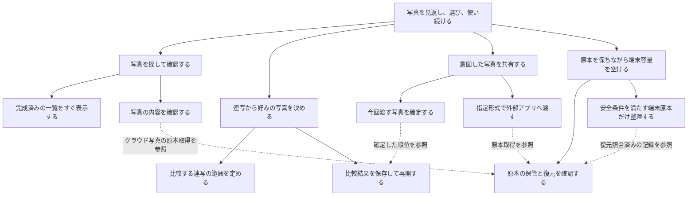

# Loupeの目的と現行設計

整理日: 2026年10月25日（日本時間）。対象は `ab903e5` と、この時点の作業ツリー。

本書は既存要件とコードを照合した設計の整理であり、新機能の採用や挙動変更の合意ではない。[design.md](design.md)は設計の履歴、[README](../README.md)は利用方法と過去の検証記録として残す。本書の契約は既存要件を整理したもので、実装前に作成された契約とは扱わない。

調査開始時点でREADME、`GalleryIndex.java`、`MainActivity.java`に未コミット変更があり、`IndexRefreshRequests.java`とそのテストが未追跡だった。写真追加の反映改善として本書に含める。最初の整理では文書のみ変更し、その後の依頼で共有準備と順位保存を分離した。分離前の契約と実施結果は末尾に記録する。

## 文脈と最上位の目的

個人のAndroid端末で、撮った写真を見返し、連写から好みの写真を選び、希望するアプリへ渡す。原本をクラウドに保管し、端末容量を空けた後も写真を利用できるようにする。

Android 11以降を対象とする。RAWの現像エンジンを作るのではなく、カメラの埋め込みJPEGを使う。Amazon Photosの非公式接続は既存の試作方式であり、将来の接続継続を保証しない。閲覧・選抜・共有では端末原本を変更せず、削除は明示的に有効化する容量整理だけが担う。

以下の親子関係は、既存の要件を今回整理したもの。目的名自体が過去に合意されたという意味ではない。

実線は親の条件を具体化する関係、点線は他の目的の保証への依存。SQLite、ハッシュ、キャッシュ、Androidジョブは実現手段であり、その名前をそのまま利用者の目的にしない。

## P1: 写真を探して確認する

- 機能: アルバム・機種から写真を探し、一覧、拡大、前後移動で内容を確認する。
- 要件: 全件走査を毎回待たず保存済み一覧を開ける。追加写真を裏で反映する。RAWは埋め込みJPEG、JPEGは画像そのものを表示する。原本取得に失敗しても取得済みプレビューを残す。
- 根拠・状態: `design.md`の閲覧、プレビュー、v0.11索引は既存設計。300msの更新要求は作業ツリーのREADMEに記録された現行仕様であり、新たな反映時間保証ではない。

### P1.1 完成済みの一覧をすぐ表示する

- 不変条件: 索引は閲覧用であり、同期済み判定や削除許可に用いない。更新中は直前に完成した索引を読む。
- 事前条件: 写真アクセス権がある範囲を走査する。初回は索引作成が必要。
- 事後条件: 写真・アルバム・連写所属・更新状態を一つのDBトランザクションで置換する。失敗・キャンセルでは途中の索引を公開しない。
- 一覧の背景反映: 反映直前に先頭可視行の写真と行上端を保持し、更新後は同じ写真を含む束の行へ復元する。対象が消えた場合は元のセル位置を新しい範囲内へ丸める。ヘッダーの途中表示は維持し、初回の空一覧だけ保存済み位置を使う。`GalleryPosition`と`ScrollingGrid`が担当。原本・順位・タグ・選択は変更しない。
- 更新契約: 画面の変更通知は最初の通知から300ms後に要求する。更新中の追加要求は次回へまとめ、強制要求を優先する。これは表示完了までの300ms保証ではない。定期更新もAndroidの実行制御を受ける。
- 実装: [GalleryIndex.java](../app/src/main/java/jp/nano/rawgallery/GalleryIndex.java) `load/rebuild/signature`、[IndexRefreshRequests.java](../app/src/main/java/jp/nano/rawgallery/IndexRefreshRequests.java) `start/finish`、[MainActivity.java](../app/src/main/java/jp/nano/rawgallery/MainActivity.java) `mediaObserver/refreshIndex`、[GalleryIndexJob.java](../app/src/main/java/jp/nano/rawgallery/GalleryIndexJob.java)。主な位置はそれぞれ85、117、154行、8行、64・653行。
- 検証: 更新要求の単体回帰テスト成功。DBのロールバック、実端末での通知、外部ストレージは今回未検査。READMEの約2.5秒という実測は小さな検証JPEGに限る過去記録。

### P1.2 写真の内容を確認する

- 不変条件: 閲覧で原本を変更しない。RAWは全体探索で構造を検証したJPEG候補のうち最大画素数を選ぶ（詳細・既知の先頭補正は[RAW抽出契約](raw-extraction.md)）。向きを一度だけ適用する。抽出失敗を別の現像結果で隠さない。
- 事前条件: 原本または保存済みプレビューへアクセスできること。クラウド原本の取得はP5に依存する。
- 事後条件: 先に小サイズプレビューを表示し、原本取得成功後に高画質表示へ移る。取得失敗ではプレビューと失敗表示を残す。
- 実装: [RawPreview.java](../app/src/main/java/jp/nano/rawgallery/RawPreview.java) `inspect/bytes/candidate`（77・115・261行）、[PhotoRepository.java](../app/src/main/java/jp/nano/rawgallery/PhotoRepository.java) `scan/sourcePreview/fullPreview/bitmap`、[MainActivity.java](../app/src/main/java/jp/nano/rawgallery/MainActivity.java) `showPhoto`（823行）、`ZoomImageView`。
- 検証: 抽出方式とエラー経路を読解。実写真の抽出一致、回転、拡大操作は今回未検査。READMEにある8枚の一致は過去の検証結果であり全RAW形式の保証ではない。

## P2: 連写から好みの写真を決める

- 機能: 連写をまとめ、2枚ずつ比較し、全写真の順位と同順位を決める。
- 要件: 比較範囲が明確で、途中保存・再開・一手戻しができる。判断は原本の削除や移動を起こさない。
- 根拠・状態: 連写と保存は`design.md`。同順位はREADME v0.14と現行コードによる後続仕様。旧「同順位は扱わない」は現行契約ではない。
- 上位との対応: P1の見やすさとは別に、写真を選ぶための比較範囲と判断結果を保証する。

### P2.1 比較する範囲を定める

- 不変条件: 機種・保存先・RAW/JPEG区分が同じで、隣接する撮影時刻差が閾値以内の写真だけをまとめる。不明な撮影時刻・機種は単独扱い。追加日時や更新日時で連写を推測しない。
- 仕様: 無効・1・2・3秒、初期値1秒。隣接差の連鎖なので束全体の時間幅が閾値を超えることはある。カメラの連写フラグを確認したという意味ではない。
- 事後条件: 元の一覧順に代表を配置し、原本、同期、整理の単位は1枚のまま保つ。
- 実装: [BurstGroups.java](../app/src/main/java/jp/nano/rawgallery/BurstGroups.java) `group`（20行）、`GalleryIndex.rebuild`が機種・保存先・形式のstreamを作る。
- 検証: 8ケースの単体検査成功。実写真のメタデータ取得は今回未検査。

### P2.2 比較結果を保存して再開する

- 不変条件: 対象は開いた束の写真集合に限定する。集合が変われば別記録。判断結果と今回共有する選択状態は別に持つ。
- 事前条件: 写真IDが空でなく重複しない。未完了の比較で両方のプレビューが表示できた後に選択する。
- 事後条件: 選択・同順位・一手戻しで次の履歴を作り、永続保存成功後に画面の順位状態を進める。保存失敗なら次の比較に進まない。同順位は1位・1位・3位のように表示する。
- 実装: [PhotoRanking.java](../app/src/main/java/jp/nano/rawgallery/PhotoRanking.java) コンストラクタ・`choose/tie/undo/best/rankOf`、[MainActivity.java](../app/src/main/java/jp/nano/rawgallery/MainActivity.java) `rankingFor/openRanking/saveRanking/rankingCandidate`、[RankingStore.java](../app/src/main/java/jp/nano/rawgallery/RankingStore.java) `load/save`、`ComparisonLayout`。順位のキー生成・読込・commitはRankingStoreへ分離済み。
- 検証: 順位100順列、再開・undo・不正入力、比較レイアウトの単体検査成功。RankingStoreの保存失敗の戻り値・既存キーとの互換性はホストテストで検査済み。Androidのディスク書込み失敗と実画面の操作は未検査。

## P3: 今回渡す写真を確定する

- 機能: 写真や連写枠を選び、選択済み写真から共有対象を決める。
- 要件: 順位の保存を変えずに共有範囲を変えられる。未選択写真を勝手に追加しない。未確定の連写を確定済みと扱わない。
- 根拠・状態: README v0.14の後続仕様を整理。既存設計文書には不足していた契約。
- 不変条件: `対象 ⊆ 明示選択した写真`。ベスト限定なら対象はその中の確定1位すべてと単写真。同率1位を1枚へ勝手に絞らない。対象IDの重複を除く。
- 事前条件: 選択する枠と、その枠が含む写真が特定できること。選択開始時にベスト限定をオンにする。
- 事後条件: ベスト限定オフなら選択した全写真。オンで未確定の束があれば、その束を未確定として返し、比較へ進む・選択へ戻る・確定分だけ共有する選択肢を示す。枠数と実対象枚数を区別する。
- 参照: P2の確定順位を読む。P4へ渡す直前に対象リストを固定する。
- 実装: [BestShotSelection.java](../app/src/main/java/jp/nano/rawgallery/BestShotSelection.java) `resolve`（11行）、[MainActivity.java](../app/src/main/java/jp/nano/rawgallery/MainActivity.java) `resolveSelection/shareSelection/shareMenu`（245・338・1170行）。
- 検証: 同率、単写真、未確定、部分選択、限定オフ、空選択の単体検査成功。比較から選択へ戻る画面遷移は今回未検査。

## P4: 指定形式で外部アプリへ渡す

- 機能: 共有先と順序・形式を保存し、1枚または複数枚を共有する。
- 要件: 明示操作時だけ渡し、元の品質と向きを保つ。準備失敗で一部だけを渡さない。受信アプリへ原本の書き込み権限を渡さない。
- 根拠・状態: `design.md`の共有契約に、README v0.14の複数共有を統合した既存仕様。
- 不変条件: 原本形式ではバイト列を変更しない。JPEG原本はそのまま、RAWのJPEG共有は原本内JPEGの画素を再圧縮せず向き情報を付ける。小サイズWebPで代用しない。
- 事前条件: P3で固定した対象の全原本を準備でき、共有先が形式・複数共有を受け付けること。
- 事後条件: 全ファイルの準備成功後にのみ共有Intentを起動する。準備失敗では生成途中の共有コピーを取り除き、共有しない。権限は専用領域の対象URIに対する読み取りのみ。
- 成功境界: Loupeが確認できるのは共有先の起動まで。外部アプリでの保存・投稿完了は別であり、成功扱いに含めない。
- 実装: [MainActivity.java](../app/src/main/java/jp/nano/rawgallery/MainActivity.java) `export`、[SharePreparation.java](../app/src/main/java/jp/nano/rawgallery/SharePreparation.java) `prepare/writeCopy`、[ShareProvider.java](../app/src/main/java/jp/nano/rawgallery/ShareProvider.java) `file/openFile`（16・27行）、`ShareTargets`、[AndroidManifest.xml](../app/src/main/AndroidManifest.xml)。原本取得はP5。
- 検証: 全件準備後のIntent起動と読み取り制約を読解。共有準備の順序・形式・容量・途中失敗・中断をホストの一時ファイルで検査済み。原本取得・EXIF処理は既存実装を移動し、外部アプリへの受け渡し、失敗時の実画面、複数形式の互換性は未検査。

## P5: 原本の保管と復元を確認する

- 機能: Amazon Photosに同じ原本があるか検索し、必要なら保存し、内容を検証して復元する。
- 要件: HTTP成功だけで保管完了としない。結果不明時の重複送信を避ける。認証情報を意図しない転送先・成果物へ出さない。
- 根拠・状態: `design.md`の追加検証・自動同期・原本取得の既存契約。初回試作の「接続診断のみ」は現在の機能範囲を表さない。
- 不変条件: 検証済みは再取得した原本のサイズ・SHA-256一致を意味する。MD5は候補検索に用い、内容保証を置き換えない。クラウド原本を削除しない。
- 事前条件: 利用者のログインと原本の読み取りが必要。自動同期は対象確認後に有効化し、初期値は無効。現行の保存・取得上限は1枚512 MiB。
- 事後条件: 送信前に`pending`を永続記録する。結果不明は検索と復元照合だけを再試行する。復元と永続プレビュー保存後に`verified`を記録する。原本取得時は内容確認済みの一時ファイルを完成ファイルへ置換する。
- 失敗・再試行: 認証失敗は自動同期を停止。個別保留には再試行待ちを置く。定期バッチは最大20枚・時間制限付き。これは全写真の保管完了時刻を保証しない。
- 参照: P1・P4へ取得済み原本を供給し、P6へ照合済み記録を供給する。DB記録、プレビューファイル、クラウド保存は単一トランザクションではない。
- 実装: [CloudVerifier.java](../app/src/main/java/jp/nano/rawgallery/CloudVerifier.java) `verify/uploadAndVerify/download`（126付近・208・314行）、[ArchiveStore.java](../app/src/main/java/jp/nano/rawgallery/ArchiveStore.java) `pending/verified`（144・148行）、[OriginalCache.java](../app/src/main/java/jp/nano/rawgallery/OriginalCache.java) `obtain`（16行）、`SyncEngine.runBatch`、`CloudActivity`、`SyncJob`。
- 検証: 送信前記録・復元照合・キャッシュのハッシュ再検査を読解。今回ネットワーク接続、認証切れ、プロセス終了からの回復は未検査。READMEのアップロード等の成功は過去の特定ファイルの実測に限る。

## P6: 安全条件を満たす端末原本だけ整理する

- 機能: 保管済み写真の端末原本を解放し、プレビューとクラウド原本で引き続き利用できるようにする。
- 要件: 未同期・照合失敗・プレビュー未保存・権限不足の原本は削除しない。同期の有効化と整理の有効化を分ける。
- 根拠・状態: `design.md`の自動同期・JPEG追加仕様。初回試作の「削除なし」「保持期間未決定」は後続仕様で置き換わっている。現行初期値は7日。
- 不変条件: 対象は対応機種のRAWとアクセス可能なJPEGのうち、管理対象MediaStore原本。原本を読み取れないものは残す。クラウド削除はしない。
- 事前条件: 同期・整理がともに有効、Androidの整理権限がある、期間条件を満たす、直前の復元照合・永続プレビュー保存に成功し、端末原本のメタデータとSHA-256が一致すること。
- 期間仕様: RAWは撮影日不明なら残す。JPEGは撮影日→追加日→取得可能な作成日。すべて不明なら照合・保存後に対象となる。未来の上位日付を下位日付へ置き換えない。変更日時を作成日の代わりにしない。
- 事後条件: `releasing`を保存してから端末の1原本を削除し、削除件数1を確認後に`released`を保存する。削除後も一覧・閲覧・共有に必要な永続プレビューと記録を残す。
- 失敗境界: DBとMediaStore削除は同時確定しない。削除後に記録更新が失敗すると`releasing`が残り得る。現行走査はSHAを持つ保存記録をクラウド写真として復元するが、この途中失敗の端末試験は未実施。ファイルの並行変更を完全に排除する原子的な削除契約も確認できていない。
- 実装: [SyncPolicy.java](../app/src/main/java/jp/nano/rawgallery/SyncPolicy.java) `retentionDate/eligible`（22・28行）、[SyncEngine.java](../app/src/main/java/jp/nano/rawgallery/SyncEngine.java) `runBatch/unchanged`（89・205付近）、`ArchiveStore.verified/preview`、`PhotoRepository.scan`（164行付近）、`SyncActivity`。
- 検証: 保持期間・機種・撮影日44検査成功。削除経路は読解のみ。原本削除、長時間バックグラウンド動作、途中停止からの復帰は今回実行していない。

## 状態と保存の責務

| 状態 | 責務・保証 | 現行の担当 | 他の状態との境界 |
| --- | --- | --- | --- |
| 比較結果 | 判断履歴から順位を再構成する | `PhotoRanking`、`RankingStore` | 共有選択や原本削除を変更しない |
| 今回の選択 | 明示選択から今回の共有対象を決める | `selectedTiles`、`BestShotSelection` | 永続順位を読むだけ |
| 閲覧索引 | 完成した写真・アルバム・束を表示する | `GalleryIndex` | 削除の根拠にしない |
| 保管記録 | 原本と照合結果・復元先を保持する | `ArchiveStore` | 索引と別DB、削除と非原子的 |
| 永続プレビュー | 端末原本を解放した後も閲覧可能にする | files/archive、`CompactPreview` | 消去可能キャッシュとは別 |
| 原本キャッシュ | 必要時の取得を再利用する | `OriginalCache` | 512 MiB、次回取得時に期限・容量整理 |
| 閲覧キャッシュ | 閲覧コストを減らす | `PhotoRepository` | 256 MiB、永続プレビューの代用ではない |
| 共有コピー | 外部アプリへ限定した読取権限で渡す | `SharePreparation`、`export`、`ShareProvider` | 原本・永続プレビューと別領域 |

`ArchiveStore.key`はフォルダ・名前・サイズ・更新日時から生成される識別子であり、内容ハッシュではない。共有選択の整数index、順位保存のID、クラウド原本IDも同じ識別子ではない。名前変更や保存先変更を越えて順位を維持する保証は記録されておらず、変更するなら移行契約が必要。

## 旧記述と現行仕様の対応

| 履歴にある記述 | 現行での扱い | 根拠 |
| --- | --- | --- |
| 初回は接続診断のみ、削除しない | 初回試作限定。現在は保存・復元・任意の自動整理を持つ | design.md追加仕様、`SyncEngine` |
| 保持期間は未決定 | 現行初期値7日、設定範囲1〜365日 | README、`SyncPolicy` |
| 同順位は扱わない | v0.14で同順位を扱う | README v0.14、`PhotoRanking.tie` |
| 原本整理後のJPEG共有 | 小サイズWebPを共有せず原本から用意する | design.md原本取得の追加仕様、`export` |
| 主要操作は上部メニュー | v0.12以降、下部操作とアイコンへ変更 | README v0.12〜v0.14、`GalleryUi` |
| 写真の変更通知をまとめる | 最初の通知から300ms、更新中の要求も引き継ぐ | 作業ツリーREADME、`IndexRefreshRequests` |

## 対応の判定と残る作業

「閉」は記載した範囲の対応を確認できたこと、「開」は不一致があること、「未検査」は必要な資料や検証が不足していること。アプリ全体の安全性や完成度を表す採点ではない。

| 対象 | 要件↔機能 | 契約↔要件 | 実装↔契約 |
| --- | --- | --- | --- |
| P1 閲覧 | 閉: 閲覧・起動待ち短縮に対応 | 閉: 索引と原本取得の条件を分離 | 要求集約は閉（単体検査）、DB・表示・RAW実ファイルは未検査 |
| P2 比較 | 閉: 比較範囲と判断の保存に対応 | 閉: 同順位を後続仕様へ整合 | 計算・保存キー互換性・commit成否の伝達は閉（ホスト検査）、Androidの永続化・画面は未検査 |
| P3 対象決定 | 閉: 意図した共有範囲に対応 | 閉: 選抜と選択を分離 | 対象計算は閉（単体検査）、画面遷移は未検査 |
| P4 受け渡し | 閉: 品質と共有先指定に対応 | 閉: 全件準備と読取権限を定義 | 準備の全件成功・後片付けは閉（ホスト検査）、Android画像処理・外部アプリとの結合は未検査 |
| P5 原本保管 | 閉: 原本を使い続ける条件に対応 | 通常成功・結果不明は閉、競合・途中停止の網羅性は未検査 | 保存・復元経路は読解済み、実サービスは未検査 |
| P6 容量整理 | 閉: 原本保全と容量解放に対応 | 通常の削除条件は閉、原本の並行変更時は未検査 | 日付条件は閉（単体検査）、削除・途中失敗は未検査 |

今回見つかった明確な「開」は、旧設計文書の「同順位なし」と現行仕様の不一致、および複数選択・共有対象決定の契約が旧文書に欠けていた点。本書で後続仕様と対応を整理した。実装の不具合修正を行ったという意味ではない。

コード整理の採否:

1. 実施済み: `MainActivity`から共有準備を`SharePreparation`へ独立させた。`export`には画面起動以外に、形式決定、原本取得、コピー、容量管理、失敗時の後片付けがある。P4の全件成功契約を一つの責務に集めるのが分割の理由。行数を減らすためだけに分割しない。
2. 実施済み: 比較履歴の保存を`RankingStore`へ分けた。純粋な`PhotoRanking`は既に存在するので、別の順位モデルを増やさず、保存成功後だけ進める境界を明文化する。
3. 未実施（今回の範囲外）: 削除を含む変更の前に、`verified → releasing → released`の途中停止と、端末原本の並行変更を検証する。既存の照合・削除間の隙間をどこまで保証するかを決めてから契約・実装を変える。

既存のUI・クラウド方式・識別子・保存形式は今回変更しない。新たな抽象層の一律導入も要件とはしない。

## 今回の検証記録

### 共有準備・順位保存の分離契約（2026年10月25日、実装前）

今回の依頼でP4の共有準備とP2.2の保存をMainActivityから分離する。挙動・保存形式を変えない範囲の実装を委譲されたものとして扱う。

- `SharePreparation`: 固定済みの写真リストと共有形式を受け、全件のコピーが完成したときだけ、順序付きファイル一覧とMIME型を返す。原本取得、RAWのJPEG抽出・向き付与、共有キャッシュの24時間・512 MiB条件を既存処理から移す。準備中の例外・中断・容量超過では今回作成したコピーを削除し、部分結果を返さない。既存キャッシュの期限整理と、原本取得側のキャッシュ更新はロールバック対象ではない。ファイル削除自体の成功保証を新たに追加しない。
- 共有先選択、URIへの読み取り権限、Intent構成、共有先の対応確認・起動、画面メッセージはMainActivityに残す。共有準備には外部アプリ起動や画面更新を持たせない。ファイル生成の依存だけを差し替えて、途中失敗を検査できる境界を設ける。
- `RankingStore`: 写真IDをソートし、従来どおり`v1-`とID列のSHA-256で保存キーを生成する。SharedPreferences名`rankings`、履歴文字列、同期`commit()`を維持する。読み込みは同じ集合なら同じ履歴を再現し、不正な履歴は黙って初期化しない。保存はcommitの成否を返し、失敗時に画面の比較状態を進めない。
- 順位読み込みは比較開始とベストショット判定の双方を同じ保存責務へ寄せる。写真からIDへの対応付けと画面更新はMainActivityに残す。SharedPreferencesのcommit失敗時のメモリ上の挙動を含め、従来のAndroid保存方式を変えない。
- 検証予定: 共有の全件成功・途中失敗・容量・中断、既存キーと履歴の互換性・保存失敗のテスト。既存回帰テスト、アプリのビルドとlint。実機・外部アプリの検証結果とは分ける。

### 文書整理時の検証

2026年10月25日に現行作業ツリーで実行:

- `sh tests/ranking.sh`: 順位100順列・再開/undo・不正入力、比較配置、ベストショット対象決定が成功。
- `sh tests/index-refresh.sh`: 更新要求の集約・強制更新優先・失敗後の保留引継ぎが成功。
- `SyncPolicyTest`: 機種・保持期間・撮影日44検査成功。
- `BurstGroupsTest`: 8ケース成功。

後二者は`SyncPolicy.java`、`RawPreview.java`、`BurstGroups.java`とテストを一時ディレクトリへ`javac`でコンパイルして実行した。アプリ全体のビルド・lint・実機操作・外部サービス接続・削除は今回の文書整理では再実施していない。過去の実機記録はREADMEに残し、今回のテスト結果と混同しない。

### 分離後の検証（2026年10月25日）

- `sh tests/preparation-storage.sh`: 既存のv1キー・履歴読込み、同順位、集合順の変更、集合の分離、undo、commit失敗の伝達、不正履歴を上書きしないことを確認。共有準備は順序・拡張子・MIME型、途中失敗時の全コピー削除と既存コピー保全、容量超過、期限整理、中断時の後片付けを確認。
- `sh tests/ranking.sh`、`sh tests/index-refresh.sh`、`sh tests/cloud-policy.sh`: 成功（順位100順列など、索引要求、クラウドURL制限22検査）。
- `./gradlew assembleDebug lintDebug`: 成功。lintエラー0件・警告27件。移動した従来の`android.media.ExifInterface`にもAndroidX版を推奨する警告がある。今回は画像処理方式と依存関係を変えていない。
- `git diff --check`: 成功。

SDKを使う検証では`ANDROID_HOME=/opt/homebrew/share/android-commandlinetools`を指定。新規ホストテストのSharedPreferencesは代替実装、共有元のコピー処理は注入した代替処理であり、Androidでのディスク永続化、実際の原本コピー・RAW抽出・EXIF付与、Intent起動を実測した結果ではない。画面のcommit失敗分岐と既存コピー処理の移動はコードの差分で確認した。実機インストール、クラウド通信、外部アプリへの送信、原本削除は行っていない。

### RAW抽出拡張（2026-10-25）

一覧・原本キャッシュ・共有に51拡張子を接続。30拡張子34実ファイルを検査し21ファイルのJPEG抽出と参照照合に成功。詳細、JPEG未検出の13ファイル、未検証の形式・実機範囲は[RAW抽出の検証](raw-extraction.md)を参照。前述のRAW実ファイル未検査という記録を、この追加検証の範囲で更新する。

## その他メニューの初期表示

- 目的: 操作先が途中で移動せず、その他メニューを安定して操作できる。
- 要件・契約: 共通Sheetは初回描画から下部中央、幅 `min(表示幅−24dp,560dp)`、角丸20dp、背景 `#19191b`、可視高さ48%以下で表示する。初回と再表示で中央や横から位置を修正するフレームを見せない。
- 既存の項目・ラベル・戻る・外側タップ・読み上げと、入力SheetのADJUST_RESIZEを維持する。原本・順位・タグ・選択を変更しない。
- 参照: [Issue #13](https://github.com/ktnyt/Loupe/issues/13)、[比較基準HTML](design/loupe-issue13-menu.html)。HTMLの項目や装飾はダミーであり適用範囲外。
- 実装: Dialogの内容をcreateで構築してから、show前に位置・幅・背景を設定する。高さ上限を超えた初回描画はpre-drawで止め、上限を適用したレイアウトで描画する。呼び出し元のonShowを置き換えない。
- 検証: Android 16の実機、0.17.9でアルバム・写真一覧の初回/再表示を録画確認。合成の短いリスト・長いリスト・入力シートで初描画から300msの各37〜38フレームの位置・寸法が一致し、水平中央・高さ上限と項目コールバックを確認。1.3倍文字の長いリストを含む8条件で検証。タグ入力のIME表示とキャンセルを確認。
- 未確認: TalkBack、端末設定による文字サイズ変更、画面回転・分割表示、他端末。初回描画ログとGPU送出ログは物理ディスプレイの表示時刻ではない。

### 操作の手がかり（Issue #14）

結果一覧は説明文に代えてカードと拡大印を使う。順位・ファイル名・順番を保持し、長い名前は折り返す。各行は単一の操作対象で、読み上げ名は順位と名前、クリック操作名は「拡大」。写真の読込失敗でも行の操作を失わず、拡大から標準Backで結果へ戻る。

Cloud初期画面は説明や空statusを表示しない。ログイン・同期の設定・接続と確認から明示的に操作する。実処理の状態メッセージはすべて可視にしpoliteで通知する。通信・原本・認証・削除条件を変更しない。同期の対象条件、共有の形式と失敗復帰、タグの空状態と入力エラー、安全確認、読み上げ用説明は残す。#1の推論と#17の状態表現は対象外。

### 背景処理の観測状態（Issue #36）

SyncEngineは既存の文章/時刻と同じSharedPreferences editでsyncStateCode/syncStateAtを保存する。1バッチ終了はWAITING、保留があるとPARTIALとし、全写真COMPLETEを推測しない。全体総数は未計測。

PreviewPreparationJobは既存のready/total/failed/stateと同じeditでpreparationStateCode/preparationStateAt/preparationCountsKnownを保存する。総数の走査完了後だけ件数を既知とする。readyは準備済みpreview数、failedは今回の処理失敗数で、ThumbHashの失敗はreadyと重なり得るため合計で残数を算出しない。ThumbHash単独件数は未計測。

JobState.snapshot相当の読取では旧データ・不明コード・時刻欠落はUNKNOWN。保存されたRUNNINGでも実行主体がない場合はUNKNOWNとし、過去の計測件数と更新時刻は保持する。状態保存は既存同様applyによるためプロセス停止時のdisk永続化を保証しない。UI、認証、送信、削除、タグ推論、jobの実行条件は変更しない。

## 状態表示（Issue #17）

可視の状態文を形と数値へ統一し、操作名・機能見出し・写真メタデータ・安全確認を保持する。実装前契約と全対象は[状態表示](visual-status.md)を正とする。明示した状態と原因を描画し、JobStateの未知・未計測を成功や0件と扱わない。読み上げと明示的な復帰操作を保持する。実装/実機検証は進行に応じて別記する。

## 処理状況ダッシュボード（設計・未実装）

#16の[観測契約](background-dashboard.md)と[参照HTML](design/loupe-issue16-dashboard.html)を使用する。その他から4工程と共通準備ジョブの保存済み状態を読取専用で確認する設計で、現在のAndroidに画面はまだない。未計測は—、工程別の結果と共通ジョブ結果、前面抑制条件を区別する。[実装#39](https://github.com/ktnyt/Loupe/issues/39)で実機検証まで行う。
